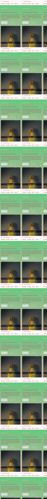
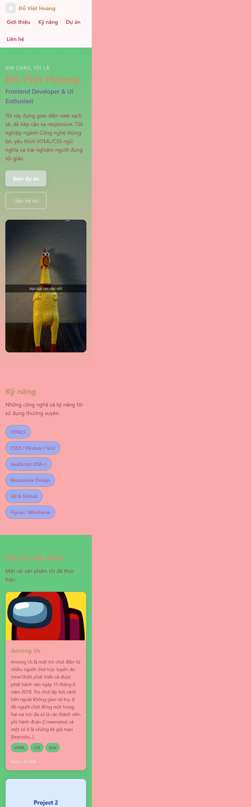
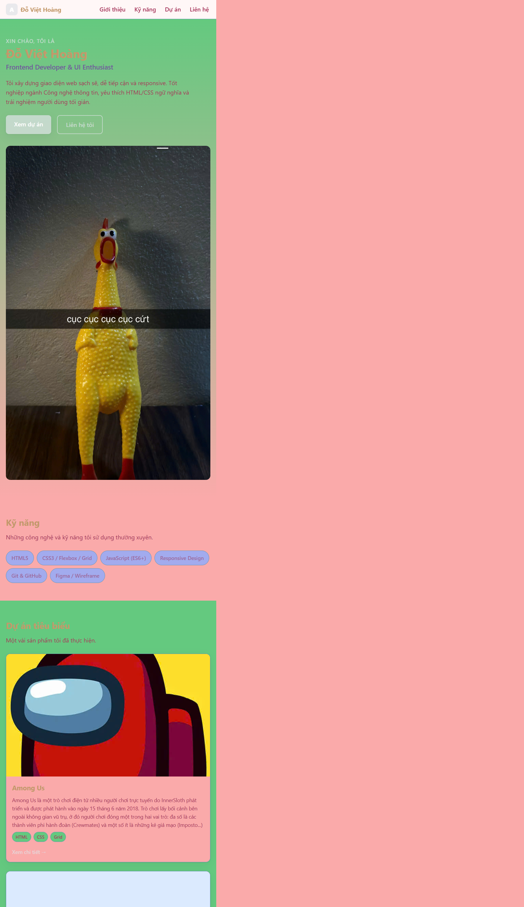

# Báo cáo kiểm thử sản phẩm - Portfolio CV

## 1. Thông tin chung

| Thông tin | Nội dung |
|---|---|
| Tên dự án | Portfolio CV - Đỗ Việt Hoàng |
| Phiên bản | v1.0.0 |
| Ngày kiểm thử | 05/11/2026 |
| Người thực hiện/đánh giá | AI QA/QC Engineer |
| Phương pháp kiểm thử | Kiểm tra mã nguồn, kiểm tra cấu trúc tài liệu, kiểm tra liên kết nội bộ và đánh giá responsive/accessibility bằng CSS/HTML |
| Môi trường đánh giá | Mã nguồn trang tĩnh HTML5/CSS3; chạy trực tiếp trên trình duyệt hoặc máy chủ tĩnh |

## 2. Bảng tổng quan trạng thái

| Nhóm tiêu chí | Tiêu chí đánh giá | Mức độ hoàn thành | Trạng thái tổng thể |
|---|---|---:|---|
| 1 | Tính đúng đắn và mức độ đáp ứng yêu cầu chức năng | 80% | Cần cải thiện |
| 2 | Giao diện, trải nghiệm người dùng và khả năng tương thích | 85% | Đạt |
| 3 | Khả năng vận hành, xử lý lỗi và hiệu năng cơ bản | 85% | Đạt |
| 4 | Bảo mật, quản lý cấu hình và dữ liệu | 90% | Đạt |
| 5 | Chất lượng mã nguồn, cấu trúc repository và tài liệu bàn giao | 70% | Cần cải thiện |
| 6 | Khả năng triển khai, kiểm thử và cung cấp minh chứng | 65% | Cần cải thiện |

**Chú thích trạng thái:** `Đạt` là tiêu chí cơ bản đáp ứng; `Cần cải thiện` có vấn đề không chặn nhưng cần xử lý trước bàn giao; `Chưa đạt` là yêu cầu bắt buộc còn thiếu hoặc sai nghiêm trọng.

## 3. Nội dung chi tiết kiểm thử

### 3.1. Tính đúng đắn và mức độ đáp ứng yêu cầu chức năng

| Hạng mục kiểm tra | Trạng thái | Ghi chú/Minh chứng cụ thể |
|---|---|---|
| Trang có phần giới thiệu cá nhân, nghề nghiệp và mô tả bản thân | Đạt | Có phần Hero và tiêu đề Frontend Developer trong `index.html`. |
| Có danh sách kỹ năng HTML/CSS/JavaScript và công cụ liên quan | Đạt | Phần `#skills` hiển thị các kỹ năng thông qua danh sách `.skill-grid`. |
| Có danh mục dự án tiêu biểu | Đạt | Phần `#projects` có các thẻ dự án sử dụng `.project-grid`. |
| Menu điều hướng truy cập đúng các phần nội dung | Cần cải thiện | Menu trỏ tới `#about`, `#skills`, `#projects`, `#contact`; cần kiểm thử thực tế trên từng trình duyệt. |
| Các liên kết dự án có nội dung đích hợp lệ | Chưa đạt | Một số nút `Xem chi tiết` đang sử dụng liên kết `href="#"`, chưa dẫn tới trang hoặc tài liệu chi tiết. |
| Thông tin liên hệ hoạt động và chính xác | Chưa đạt | Link GitHub/LinkedIn chứa dấu nội dung không hợp lệ hoặc biểu tượng trong thẻ `<a>`; cần sửa theo URL thực tế. |
| Nội dung tài liệu phản ánh đúng phạm vi sản phẩm | Đạt | `README.md`, `RELEASENOTE.md` mô tả đúng sản phẩm là trang web tĩnh. |

### 3.2. Giao diện, trải nghiệm người dùng và khả năng tương thích

| Hạng mục kiểm tra | Trạng thái | Ghi chú/Minh chứng cụ thể |
|---|---|---|
| Bố cục responsive mobile-first | Đạt | CSS dùng 1 cột ở mobile, 2 cột từ 768px và 3 cột từ 1280px. |
| Header/menu không gây tràn ngang trên màn hình nhỏ | Đạt | `.header-inner` và `.nav-list` sử dụng Flexbox cùng `flex-wrap: wrap`; `body` có `overflow-x: hidden`. |
| Ảnh không vượt quá khung chứa | Đạt | `img { max-width: 100%; height: auto; }`; ảnh thẻ dự án có `object-fit: cover`. |
| Trải nghiệm cuộn và điều hướng thuận tiện | Đạt | `html` thiết lập `scroll-behavior: smooth` và có nút `Lên đầu trang`. |
| Khả năng truy cập bàn phím | Đạt | Có quy tắc `:focus-visible` rõ ràng và HTML có các nhãn điều hướng phù hợp. |
| Hỗ trợ ưu tiên giảm chuyển động | Đạt | Media query `prefers-reduced-motion` tắt chuyển động và cuộn mượt. |
| Cú pháp HTML và cấu trúc thẻ hợp lệ | Cần cải thiện | Cần kiểm tra lại thẻ liên kết phần Liên hệ; nội dung đang có ký tự/bổ sung HTML không hợp lệ ngoài thẻ `a`. |
| Khả năng tương thích trình duyệt cần được xác minh thực tế | Cần cải thiện | Chưa có bằng chứng kiểm thử trên Chrome, Edge, Firefox và Safari. |
| Hiển thị responsive trên ba kích thước màn hình chính | Đạt | Đã lưu ảnh chụp mobile, tablet và desktop tại `docs/screenshots/` và liên kết minh chứng ngay phần dưới. |

#### Minh chứng giao diện responsive

| Thiết bị | Kích thước kiểm thử cấu hình | Minh chứng |
|---|---:|---|
| Mobile | 390 x 844 px | [mobile.png](screenshots/mobile.png) |
| Tablet | 768 x 1024 px | [tablet.png](screenshots/tablet.png) |
| Desktop | 1440 x 900 px | [desktop.png](screenshots/desktop.png) |

### 3.3. Khả năng vận hành, xử lý lỗi và hiệu năng cơ bản

| Hạng mục kiểm tra | Trạng thái | Ghi chú/Minh chứng cụ thể |
|---|---|---|
| Trang có thể mở trực tiếp bằng trình duyệt | Đạt | Chỉ dùng HTML/CSS tĩnh, không phụ thuộc backend hoặc cơ sở dữ liệu. |
| Không phát sinh lỗi tài nguyên nội bộ | Đạt | CSS được liên kết từ `assets/css/styles.css`; ảnh địa phương được đặt trong `assets/img`. |
| Không có lỗi cú pháp JavaScript | Đạt | Dự án hiện không có JavaScript runtime; không phát sinh lỗi script phía trình duyệt. |
| Có xử lý trạng thái rỗng/lỗi dữ liệu phù hợp | Đạt | Không có dữ liệu động hoặc API; các tình huống nhập liệu/lưu trữ không áp dụng. |
| Hiệu năng tải trang cơ bản | Đạt | Dự án nhỏ, chủ yếu là HTML/CSS và số lượng ảnh giới hạn. |
| Có bản ghi lỗi và kết quả kiểm thử thực thi | Cần cải thiện | Chưa lưu kết quả kiểm thử trình duyệt, Log Console và ảnh chụp màn hình minh chứng. |

### 3.4. Bảo mật, quản lý cấu hình và dữ liệu

| Hạng mục kiểm tra | Trạng thái | Ghi chú/Minh chứng cụ thể |
|---|---|---|
| Không lưu dữ liệu nhạy cảm trong mã nguồn | Đạt | Không phát hiện API key, mật khẩu, token hoặc cấu hình bí mật trong các tài liệu đã rà soát. |
| Không thu thập hoặc lưu trữ dữ liệu cá nhân người dùng | Đạt | Trang không có biểu mẫu, backend, cookie hoặc cơ sở dữ liệu. |
| Liên kết ngoài sử dụng HTTPS và đích hợp lệ | Cần cải thiện | Link GitHub/LinkedIn hiện không đúng định dạng URL hoặc không hoạt động; cần sửa trước bàn giao. |
| Không có cấu hình môi trường nhạy cảm | Đạt | README xác nhận dự án không yêu cầu file biến môi trường hoặc API riêng. |
| Dữ liệu cá nhân có thể cập nhật dễ dàng | Đạt | Thông tin được quản lý tập trung trong `index.html`; README hướng dẫn vị trí cập nhật. |

### 3.5. Chất lượng mã nguồn, cấu trúc repository và tài liệu bàn giao

| Hạng mục kiểm tra | Trạng thái | Ghi chú/Minh chứng cụ thể |
|---|---|---|
| Cấu trúc thư mục rõ ràng | Đạt | `index.html`, `assets/css`, `assets/img`, `docs` và tài liệu README được tổ chức hợp lý. |
| HTML/CSS có chú thích và tổ chức dễ đọc | Đạt | HTML chia theo Header/Main/Footer; CSS được phân vùng theo bố cục và breakpoint. |
| Tránh trùng lặp tài nguyên và sai đường dẫn | Đạt | Tài nguyên HTML/CSS hiện có mục đích rõ ràng và nằm trong thư mục tương ứng. |
| README có đầy đủ mục đích, công nghệ và hướng dẫn chạy | Đạt | README mô tả cài đặt, chạy thử và triển khai cho Windows, macOS và Linux. |
| Release notes đầy đủ theo phiên bản | Đạt | `docs/RELEASENOTE.md` có phiên bản, ngày phát hành, chức năng mới, lỗi đã sửa và hạn chế. |
| Nhật ký thay đổi AI được duy trì | Đạt | `docs/AI_LOG.md` ghi quy tắc và lịch sử thay đổi tài liệu. |
| HTML không còn lỗi cú pháp tại phần liên hệ | Chưa đạt | Nội dung thẻ GitHub trong `index.html` có chuỗi HTML bất thường và chưa đóng thẻ đúng cách. |
| Repository không chứa tài nguyên thừa hoặc không mong muốn | Cần cải thiện | Cần kiểm tra và loại bỏ file tạm, trùng lặp hoặc tài liệu không cần thiết nếu có. |

### 3.6. Khả năng triển khai, kiểm thử và cung cấp minh chứng

| Hạng mục kiểm tra | Trạng thái | Ghi chú/Minh chứng cụ thể |
|---|---|---|
| Có hướng dẫn triển khai GitHub Pages | Đạt | README hướng dẫn chọn nhánh `main`, thư mục `/ (root)` trong phần GitHub Pages. |
| Có thể triển khai bằng máy chủ tĩnh | Đạt | Trang không phụ thuộc build tool hoặc backend. |
| Có hướng dẫn triển khai Docker | Cần cải thiện | README có lệnh Docker chạy trực tiếp bằng Nginx, nhưng repository chưa có `Dockerfile` hoặc `docker-compose.yml`. |
| Có kịch bản/test case có thể truy xuất | Chưa đạt | File `docs/test_report.md` đang chứa báo cáo tổng hợp nhưng chưa có bảng test case chi tiết theo ID và kết quả thực thi. |
| Có minh chứng kiểm thử trên nhiều kích thước màn hình | Đạt | Đã cung cấp ảnh tự chụp mobile, tablet và desktop trong `docs/screenshots/`. |
| Có công cụ kiểm tra HTML/CSS tự động | Cần cải thiện | Chưa có lệnh hoặc cấu hình validator/linter trong repository. |
| Có quy trình bàn giao/phê duyệt | Cần cải thiện | Chưa có danh sách người xác nhận, bằng chứng kiểm thử và dấu phê duyệt trong repository. |

## 4. Phân loại lỗi phát hiện

| Mức độ | Nội dung lỗi | Vị trí liên quan |
|---|---|---|
| Cao | Thẻ liên kết GitHub bị hỏng/cú pháp HTML không hợp lệ | `index.html` - phần Liên hệ |
| Trung bình | Liên kết LinkedIn/GitHub không trỏ tới URL hợp lệ | `index.html` - phần Liên hệ |
| Trung bình | Các nút xem chi tiết dự án đều trỏ tới `#`, chưa có trang đích | `index.html` - phần Dự án |
| Thấp | Cần bổ sung ngày thực thi và thông tin trình duyệt trên ảnh minh chứng | `docs/screenshots/` |
| Thấp | Thiếu cấu hình triển khai Docker trong repository nếu cam kết hỗ trợ Docker | Thư mục gốc repository |

## 5. Đánh giá tổng kết & Đề xuất

### 5.1. Nhận định chung

Sản phẩm đã có đầy đủ khung chức năng cơ bản của một trang Portfolio/CV tĩnh, bố cục responsive và tài liệu dự án tương đối đầy đủ. Phiên bản v1.0.0 **chưa sẵn sàng bàn giao chính thức theo tiêu chuẩn chất lượng cao** cho đến khi các lỗi liên kết HTML và đường dẫn nội dung được khắc phục.

### 5.2. Các công việc cần ưu tiên trước bàn giao

1. Sửa thẻ liên kết GitHub trong phần Liên hệ để HTML hợp lệ.
2. Cập nhật GitHub và LinkedIn bằng URL đầy đủ, có nội dung hoặc chế độ liên kết chính xác.
3. Thay liên kết `href="#"` của nút dự án bằng URL trang chi tiết hoặc loại bỏ liên kết nếu chưa triển khai.
4. Chạy kiểm thử thực tế trên các trình duyệt chính và các breakpoint mobile/tablet/desktop.
5. Bổ sung ảnh chụp màn hình, kết quả kiểm thử, thông tin thiết bị và ngày kiểm thử thực tế.
6. Nếu Docker là phương án bàn giao bắt buộc, bổ sung `Dockerfile`/`docker-compose.yml` hoặc điều chỉnh tài liệu để không tuyên bố cấu hình chưa có.

### 5.3. Kiến nghị trạng thái bàn giao

- **Kết luận:** Cần cải thiện trước khi bàn giao.
- **Điều kiện chấp nhận tối thiểu:** Không còn lỗi HTML ở phần liên hệ; toàn bộ liên kết hiển thị hoạt động; responsive được xác minh trên ít nhất ba breakpoint; có minh chứng kiểm thử và tài liệu triển khai khớp với repository.
